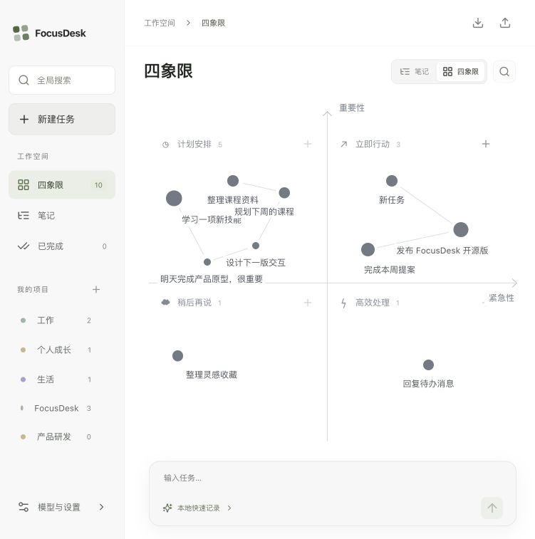

# 松果 Pinecone

原名 FocusDesk。品牌升级保留原有应用标识与数据存储，已有任务、项目和模型配置可继续使用。


简洁的白色四象限工作台。

一个开源、本地优先的个人工作台。用自然语言记下任务，在四象限与大纲笔记之间自由切换，把项目文件夹和待办放在一起。

**Tauri 2 · React 19 · TypeScript · SQLite · MIT**




## 已实现

- 四象限 / 大纲笔记双视图，共用同一份任务数据，切换时保留位置、大小、日期和文件夹。
- 大纲按「紧急重要 / 紧急不重要 / 重要不紧急 / 不紧急不重要」分组，支持折叠、行内编辑、Enter 连续新建、多行笔记、完成任务和 Markdown 导出。
- 任务行悬停时显示左侧展开箭头与右侧笔记快捷入口；展开后箭头常驻。圆点仅作列表标记，笔记可以直接打开。
- 每个任务有独立的大纲笔记：多级条目、Enter 新建、Tab / Shift+Tab 缩进、子项折叠、拖动排序。内部条目不生成四象限任务。
- 笔记支持文字颜色、背景色、加粗、斜体、下划线、删除线；支持直接粘贴剪贴板图片、选择本地图片、撤销和重做。
- 白色 UI，真实 XY 坐标轴：横轴紧急性向右增加，纵轴重要性向上增加。
- 四象限任务画布：拖动圆点跨象限移动，在详情中使用优先级滑杆调整大小。
- Obsidian 风格白色图谱：石墨灰小节点、外置标题、细连线，悬停或选中时突出关联节点。
- 节点直径为 10–28px，越大代表象限内优先级越高；旧任务优先级自动映射，通过详情中的优先级滑杆调整大小。
- 象限内任务关系图：默认按创建时间连线；支持手动连接、断开、沿连接跳转，以及恢复时间顺序。连线随圆点拖动和缩放更新。
- 点击圆点展开详情：标题、说明、日期、所属项目、象限、优先级。
- 桌面版选择、绑定并打开本地文件夹。
- 自定义 API URL、API Key、Model Name，连接测试。
- OpenAI 兼容 Chat Completions 接口；支持提供兼容端点的云服务和本地 Ollama。
- 自然语言经模型拆成多个任务，并识别重要性、紧急性和截止日期。
- 无模型时可直接记录，按关键词做基础分类，支持今天、明天、后天及明确日期。
- 我的项目支持新建、改名、删除和筛选，空项目也会保存；改名同步更新任务，删除项目保留任务和本地文件夹。
- 左上角全局搜索（⌘K / Ctrl+K）：搜索所有任务的标题、完整笔记、项目、日期、文件夹路径、完成状态和象限，不受当前项目筛选影响。支持方向键选择、Enter 跳转。
- 任务完成与恢复、删除。
- 自动保存：桌面版 SQLite；网页预览 IndexedDB（自动读取旧 localStorage 数据）。
- JSON 导出与合并导入；包含项目、手动连线、大纲结构、文字格式与内嵌图片；导出不含 API Key，导入按任务 ID 去重。

## 任务内部笔记

在任务详情点击「打开笔记」，进入独立编辑区。任务列表与已完成列表也提供笔记入口。笔记标题与任务名称同步，内容自动保存。


- `Enter` 新增同级条目；`Tab` 缩进；`Shift+Tab` 减少缩进。点击小箭头折叠子项，拖动圆点移动条目及其子项。
- 选中文字后使用工具栏设置格式、文字颜色或背景色；「恢复默认」清除相应颜色。
- `⌘V / Ctrl+V` 粘贴图片，或点击图片按钮选择文件。图片随笔记存储，无需图床。
- 全局搜索包含折叠子项和已完成任务的笔记正文。JSON 备份完整保留格式和图片；Markdown 导出保留大纲、常见文字格式和内嵌图片，不保留文字颜色、背景色和折叠状态。

## 任务连接

点击任务，在「任务连接」中选择同象限任务，或点击「在画布上连接」后选择目标圆点。连接带有方向，可构建分支关系。默认连线为浅灰细线，悬停或选中节点时突出关联关系和方向；第一次手动增删会保留已有连接，并将当前象限切换为手动模式。象限标题旁的恢复按钮可重新按创建时间连接。已完成任务不参与画布连线；跨象限移动会移除该任务原有手动连接。

## 开始开发

需要 Node.js 22.12+、Rust stable，以及 [Tauri 2 平台依赖](https://v2.tauri.app/start/prerequisites/)。

```sh
npm ci
npm run tauri dev
```

macOS 需要 Xcode Command Line Tools；Windows 需要 Microsoft C++ Build Tools 和 WebView2；Linux 需要 WebKitGTK 4.1 等系统库。仓库中的 GitHub Actions 展示了 Ubuntu 安装命令。

仅预览界面：

```sh
npm ci
npm run dev
```

打开 http://127.0.0.1:1420 。网页预览支持任务交互和保存，系统文件夹选择与打开需要桌面版。网页直连模型还需要服务允许跨域；桌面版经 Rust 请求，不受浏览器 CORS 限制。

## 模型配置

点击左下角「模型与设置」：

| 配置 | 示例 |
| --- | --- |
| API URL | `https://api.openai.com/v1` 或 `http://localhost:11434/v1` |
| API Key | 服务提供商给出的 Key；本地模型通常可留空 |
| Model Name | 服务支持的准确模型名称，例如 `gpt-4.1-mini` 或 `qwen3:8b` |

API URL 也可以填完整的 `/chat/completions` 地址。点击「测试连接」，保存后在底部输入任务。Model Name 留空即使用本地快速记录。

示例：

> 明天下午交项目提案，很重要；本月学习 Rust，不着急；今天回复活动确认，优先级低。

只发送用户输入及任务解析提示词，不读取关联目录中的文件。任务与模型配置（包括 API Key）保存在本机数据库 / 浏览器存储；当前版本没有系统钥匙串集成。首次启动带有 4 个可编辑示例任务，可逐个删除。

## 构建

```sh
npm test
npm run build
npm run tauri build
```

桌面产物在 `src-tauri/target/release/bundle/`。`.github/workflows/build.yml` 在 macOS、Windows、Ubuntu 上构建并上传安装包，推送仓库到 GitHub 后即可运行。当前工作流不包含平台签名和公证；公开发布正式安装包时可接入相应签名凭据。

## 项目结构

```text
src/
  App.tsx          工作台、拖拽、详情卡片、模型设置
  Outline.tsx      大纲笔记视图与行内编辑
  Graph.tsx        关系图绘制与连接编辑
  GlobalSearch.tsx 全局搜索
  ProjectEditor.tsx 项目管理
  workspace.ts     连接、项目、搜索、数据迁移
  workspace.test.ts 工作台逻辑测试
  styles.css       界面样式与响应式布局
  model.ts         任务结构、位置转换、本地解析
  ai.ts            模型请求与任务解析
  TaskNotes.tsx    任务内部富文本大纲编辑器
  notesEditor.tsx  大纲条目、折叠和图片粘贴
  notes.ts         笔记搜索文本与 Markdown 导出
  storage.ts       SQLite / IndexedDB 持久化
  model.test.ts    分类、跨象限坐标、模型协议测试
src-tauri/
  src/lib.rs       模型 HTTP 请求与数据库初始化
  capabilities/   系统插件权限
  tauri.conf.json  桌面窗口与打包配置
```

第一版没有账号、云同步和文件内容索引。任务路径按设备保存，迁移到其他电脑后可在任务详情中重新绑定目录。

## 验证状态

任务笔记版本已通过 17 项测试与前端构建。桌面各平台的验证情况见 [VERIFICATION.md](VERIFICATION.md)。

## 参与和许可

欢迎提交问题和 Pull Request，见 [CONTRIBUTING.md](CONTRIBUTING.md)。代码采用 [MIT License](LICENSE)。

## 品牌与宣传片

中文名「松果」，英文名「Pinecone」。品牌主张：让重要的事，浮现。

- [品牌素材](assets/brand/)：SVG、透明 PNG、应用图标与品牌展示板。
- [横屏宣传片](media/Pinecone-landscape-1920x1080.mp4) · [竖屏宣传片](media/Pinecone-vertical-1080x1920.mp4)，30 秒，中文短文案与音乐，无旁白。
- [视频渲染源码](scripts/render-promo.py)：本地使用 Python、Pillow、NumPy、FFmpeg 渲染，默认字体路径适配 macOS。

宣传片为功能示意动效；竖屏画幅不表示已推出移动端应用。
