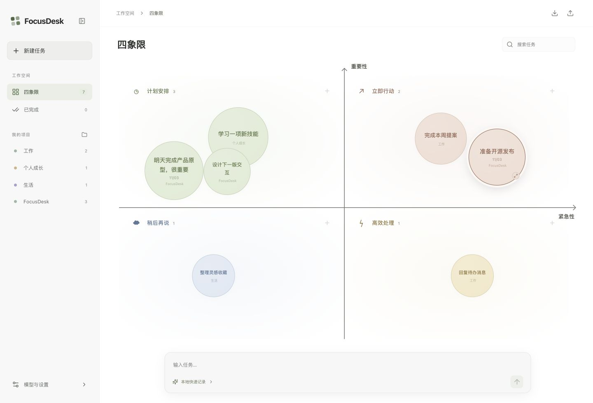
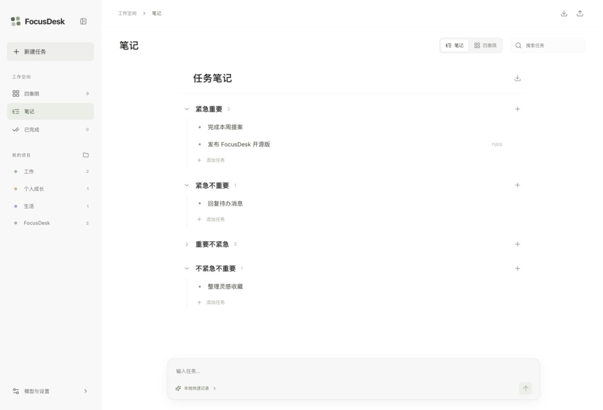

# FocusDesk

简洁的白色四象限工作台。

一个开源、本地优先的个人工作台。用自然语言记下任务，在四象限与大纲笔记之间自由切换，把项目文件夹和待办放在一起。

**Tauri 2 · React 19 · TypeScript · SQLite · MIT**





## 已实现

- 四象限 / 大纲笔记双视图，共用同一份任务数据，切换时保留位置、大小、日期和文件夹。
- 大纲按「紧急重要 / 紧急不重要 / 重要不紧急 / 不紧急不重要」分组，支持折叠、行内编辑、Enter 连续新建、多行笔记、完成任务和 Markdown 导出。
- 白色 UI，真实 XY 坐标轴：横轴紧急性向右增加，纵轴重要性向上增加。
- 四象限任务画布：拖动圆点跨象限移动，拖动右下角边缘控制点调整大小。
- 圆点越大，代表同一象限中优先级越高。
- 点击圆点展开详情：标题、说明、日期、所属项目、象限、优先级。
- 桌面版选择、绑定并打开本地文件夹。
- 自定义 API URL、API Key、Model Name，连接测试。
- OpenAI 兼容 Chat Completions 接口；支持提供兼容端点的云服务和本地 Ollama。
- 自然语言经模型拆成多个任务，并识别重要性、紧急性和截止日期。
- 无模型时可直接记录，按关键词做基础分类，支持今天、明天、后天及明确日期。
- 项目筛选、任务搜索、完成与恢复、删除。
- 自动保存：桌面版 SQLite；网页预览 localStorage。
- JSON 导出与合并导入；导出不含 API Key，导入按任务 ID 去重。

## 开始开发

需要 Node.js 22.12+、Rust stable，以及 [Tauri 2 平台依赖](https://v2.tauri.app/start/prerequisites/)。

```sh
npm ci
npm run tauri dev
```

macOS 需要 Xcode Command Line Tools；Windows 需要 Microsoft C++ Build Tools 和 WebView2；Linux 需要 WebKitGTK 4.1 等系统库。仓库中的 GitHub Actions 展示了 Ubuntu 安装命令。

仅预览界面：

```sh
npm ci
npm run dev
```

打开 http://127.0.0.1:1420 。网页预览支持任务交互和保存，系统文件夹选择与打开需要桌面版。网页直连模型还需要服务允许跨域；桌面版经 Rust 请求，不受浏览器 CORS 限制。

## 模型配置

点击左下角「模型与设置」：

| 配置 | 示例 |
| --- | --- |
| API URL | `https://api.openai.com/v1` 或 `http://localhost:11434/v1` |
| API Key | 服务提供商给出的 Key；本地模型通常可留空 |
| Model Name | 服务支持的准确模型名称，例如 `gpt-4.1-mini` 或 `qwen3:8b` |

API URL 也可以填完整的 `/chat/completions` 地址。点击「测试连接」，保存后在底部输入任务。Model Name 留空即使用本地快速记录。

示例：

> 明天下午交项目提案，很重要；本月学习 Rust，不着急；今天回复活动确认，优先级低。

只发送用户输入及任务解析提示词，不读取关联目录中的文件。任务与模型配置（包括 API Key）保存在本机数据库 / 浏览器存储；当前版本没有系统钥匙串集成。首次启动带有 4 个可编辑示例任务，可逐个删除。

## 构建

```sh
npm test
npm run build
npm run tauri build
```

桌面产物在 `src-tauri/target/release/bundle/`。`.github/workflows/build.yml` 在 macOS、Windows、Ubuntu 上构建并上传安装包，推送仓库到 GitHub 后即可运行。当前工作流不包含平台签名和公证；公开发布正式安装包时可接入相应签名凭据。

## 项目结构

```text
src/
  App.tsx          工作台、拖拽、详情卡片、模型设置
  Outline.tsx      大纲笔记视图与行内编辑
  styles.css       界面样式与响应式布局
  model.ts         任务结构、位置转换、本地解析
  ai.ts            模型请求与任务解析
  storage.ts       SQLite / localStorage 持久化
  model.test.ts    分类、跨象限坐标、模型协议测试
src-tauri/
  src/lib.rs       模型 HTTP 请求与数据库初始化
  capabilities/   系统插件权限
  tauri.conf.json  桌面窗口与打包配置
```

第一版没有账号、云同步和文件内容索引。任务路径按设备保存，迁移到其他电脑后可在任务详情中重新绑定目录。

## 验证状态

已通过前端构建、6 项测试、Rust 编译检查和 macOS release 应用打包。详见 [VERIFICATION.md](VERIFICATION.md)。

## 参与和许可

欢迎提交问题和 Pull Request，见 [CONTRIBUTING.md](CONTRIBUTING.md)。代码采用 [MIT License](LICENSE)。
